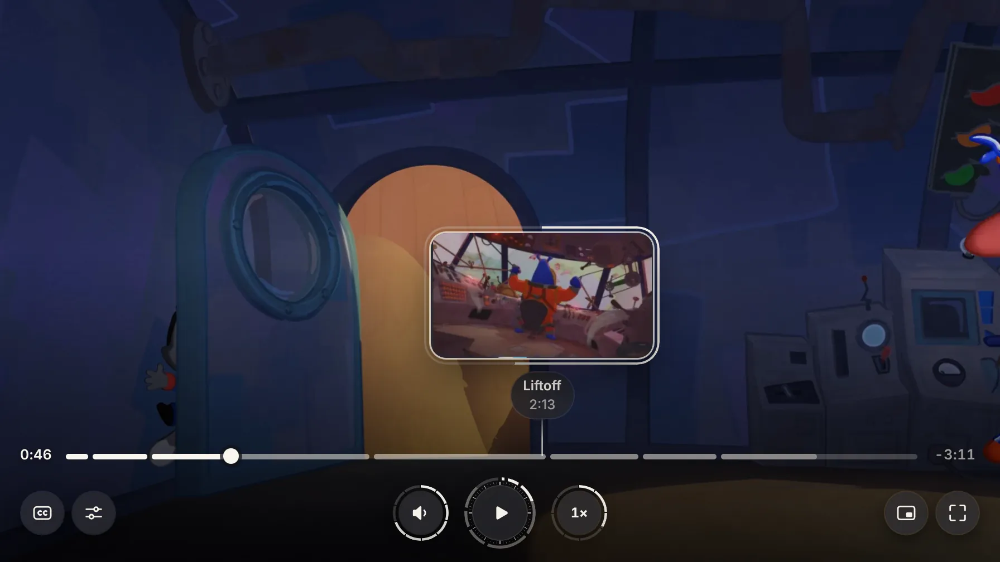
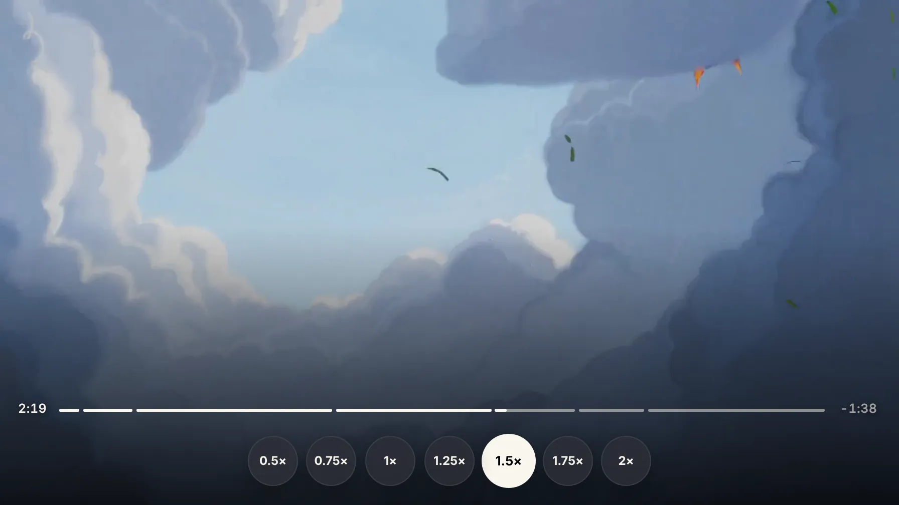
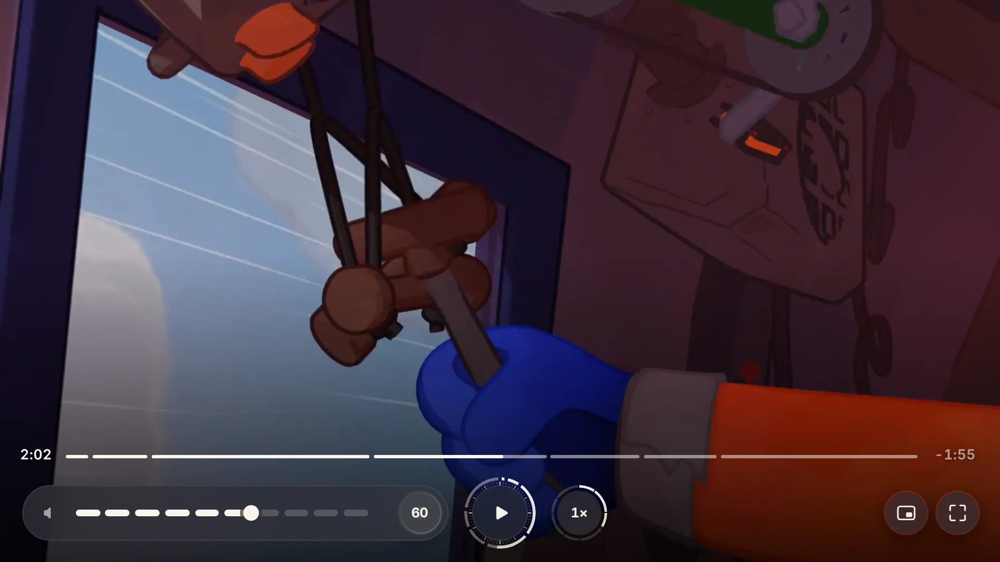
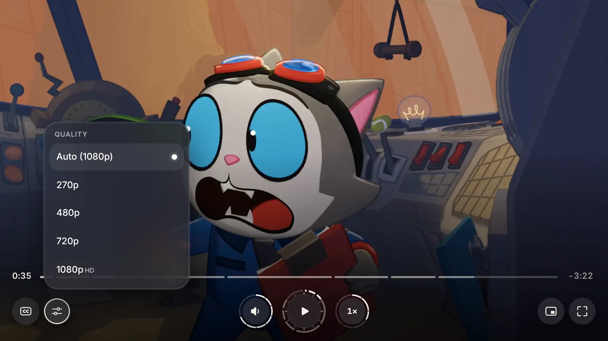
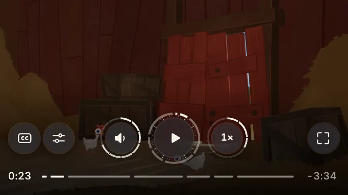

# Iris

[](https://github.com/Sabikbiswas/iris-player/actions/workflows/build.yml)
[](LICENSE)
[](https://videojs.org)

A skin for [Video.js 10](https://videojs.org), shaped like a camera lens and read like a watch. A lens play button with aperture blades and a progress ring, volume and speed dials either side (volume stretches into a ten-step capsule, speed rolls out into seven keys), keyboard feedback that grows the dial you would have touched, a ten-step loading ring that ticks like a watch, and a scrub preview that starts as a small lens and irises open to the whole frame.

Made by Sabik Biswas for the Video.js Skins Design Challenge on Contra.

**Live showcase:** https://iris-player.netlify.app · **Workbench:** https://iris-player.netlify.app/workbench/



| Speed in one move | Volume capsule |
| --- | --- |
|  |  |
| **Quality from Mux** | **Phone layout** |
|  |  |

## Use it

### One script

Build the project (`npm run build:all`) and host `dist-site/iris.js` with its `iris-chunks/` folder, or load it from the deployed showcase. Then:

```html
<script type="module" src="https://iris-player.netlify.app/iris.js"></script>

<media-i18n>
  <video-player>
    <iris-skin>
      <mux-video src="https://stream.mux.com/PLAYBACK_ID.m3u8" playsinline crossorigin>
        <track kind="chapters" src="chapters.vtt" srclang="en" default>
        <track kind="captions" src="captions.vtt" srclang="en" label="English">
      </mux-video>
    </iris-skin>
  </video-player>
</media-i18n>
```

`<iris-skin>` wraps any Video.js media element (`<video>`, `<mux-video>`, `<hlsjs-video>`, …). Several players can share a page. The showcase sends `Access-Control-Allow-Origin: *` (`site/public/_headers`, `vercel.json`), so other sites can load the script and the caption files from it.

### An iframe, when a site builder won't take scripts

`embed.html` on the showcase is the Wing It! player alone. Pick the accent (hex, without `#`) and the corner radius (0–48 px) in the address:

```html
<iframe src="https://iris-player.netlify.app/embed.html?accent=0D99FF&radius=12"
  title="Iris video player playing Wing It!" loading="lazy"
  allow="fullscreen; picture-in-picture" allowfullscreen
  style="display:block;width:100%;aspect-ratio:16/9;border:0;border-radius:12px"></iframe>
```

### Own the source

The skin is plain HTML and CSS in the Video.js skin format, in [`src/video/`](src/video):

- `skin.html`: the markup, built from Video.js 10 components plus one `<iris-behavior>` element.
- `skin.css`: the styles.
- `elements.ts`: the Video.js elements the markup uses.
- `behavior.ts`: `<iris-behavior>`, a small script: it keeps the speed gauge's label and ring current, opens the speed scale on hover with a mouse, lets you slide along its stops, sizes the volume capsule, turns menus into a sheet across the bottom of phone-sized players, and shows the player's own focus ring for keyboard focus only.

Copy them into a project made with `npx @videojs/cli skin create`, or use them as they are.

## Make it yours

Iris honors the public Video.js skin properties:

| Property | What it changes |
| --- | --- |
| `--media-accent-color` | Progress, rings, fills and the selected menu item |
| `--media-accent-text-color` | Text on accent surfaces |
| `--media-border-color` | The frame's hairline |
| `--media-border-radius` | The frame and the controls' corners |
| `--media-font-family` | Every label |
| `--media-object-fit`, `--media-object-position` | How the video fills the frame |
| `--media-scale-unit` | Every length (16px by default); steps up in large full screen and down on small players |

## What's in the box

- Play/pause, seek with chapters, current and remaining time (as plain readouts), volume and mute (a ten-step scale that stretches out of the volume key), a speed scale (2× to 0.5×, one tap or a slide), captions, picture in picture, full screen.
- Settings opens straight on quality. Audio and Captions rows appear only when a video has more than one choice, and the Settings key hides when there is nothing to set.
- Space, K or a click on the picture: a lens echo in the middle of the frame shuts its blades for pause and opens them for play.
- On phones and touch screens, play/pause is one motion inside the lens: its icon blends into the other one. No echo, no press dip, and no focus ring after a tap (a key press brings the rings back).
- Before-play, buffering, error, ended and replay states.
- Video.js hotkeys (Space/K, J/L, ←/→, ↑/↓, M, F, C, I, 0–9, Home/End, < and >), gestures (tap, double-tap to seek or go full screen) and the status announcer.
- Phone-sized players move the keys above the timeline so the preview has room to open, and open speed and quality as a sheet across the bottom of the player.

## Accessibility

- Text and icons sit on dark frosted surfaces, never on the picture, so they stay legible over bright, dark and busy frames.
- Every control works by keyboard, with a visible focus ring and a dark halo.
- Touch screens get about 44px hit areas for the keys and the timeline.
- Reduced motion turns sweeps, spins and morphs into short fades. Forced colors use system colors.
- axe-core 4.14 (WCAG 2.1 and 2.2 AA rules) finds no violations at desktop and phone size, with the film playing and Settings open, in Chrome.
- On phone-sized players, keyboard order follows the keys-above-timeline layout through CSS `reading-flow` (Chrome and Edge 137+). Other browsers tab in source order: timeline first, then the keys.

## Browser support

Video.js 10's own support: Chrome and Edge 111+, Firefox 121+, Safari and iOS 16.4+. The quality menu appears when Video.js plays HLS through hls.js (MediaSource or ManagedMediaSource); with the browser's native HLS there are no renditions to choose from, so the row hides itself.

## Develop

Needs Node 20.19+ or 22.12+.

```sh
npm ci
npm run dev          # the Video.js skin workbench
npm run build:all    # workbench + showcase + drop-in script into dist-site/
npm run typecheck
```

| Folder | What it is |
| --- | --- |
| [`src/video/`](src/video) | The skin |
| [`src/iris.ts`](src/iris.ts) | The `<iris-skin>` drop-in element |
| [`site/`](site) | The showcase page: an engraved speed ring that follows the hero player's speed, the controls up close, a live accent and radius bench, all 25 player states captured from the real player (`site/public/states/`), design thinking, a to-scale drawing and spec sheet, accessibility, install steps, and a footer iris that closes as the page ends |
| [`apps/preview/`](apps/preview) | The Video.js skin workbench (from the CLI) |

Every push to `main` is built by [GitHub Actions](.github/workflows/build.yml) (`npm ci`, typecheck, `build:all`). Deploy with `npm run deploy netlify` (or `vercel`, `cloudflare`). `netlify.toml` and `vercel.json` build everything and publish `dist-site/`.

## Credits

- Film: *Wing It!* (CC) Blender Foundation | [studio.blender.org](https://studio.blender.org/projects/wing-it/), licensed [CC BY 4.0](https://creativecommons.org/licenses/by/4.0/). Streamed from [Mux](https://www.mux.com). The film itself is not in this repository.
- Chapters and sound captions were written for this demo. The film has no dialogue; each sound cue is timed to the film's audio (onsets and loudness measured from the Mux stream, sounds identified from the picture and an AudioSet sound tagger).
- Built on [Video.js 10](https://videojs.org) and its skin workbench.

## License

Apache 2.0. See [LICENSE](LICENSE) and [NOTICE](NOTICE). Copyright 2026 Sabik Biswas.
